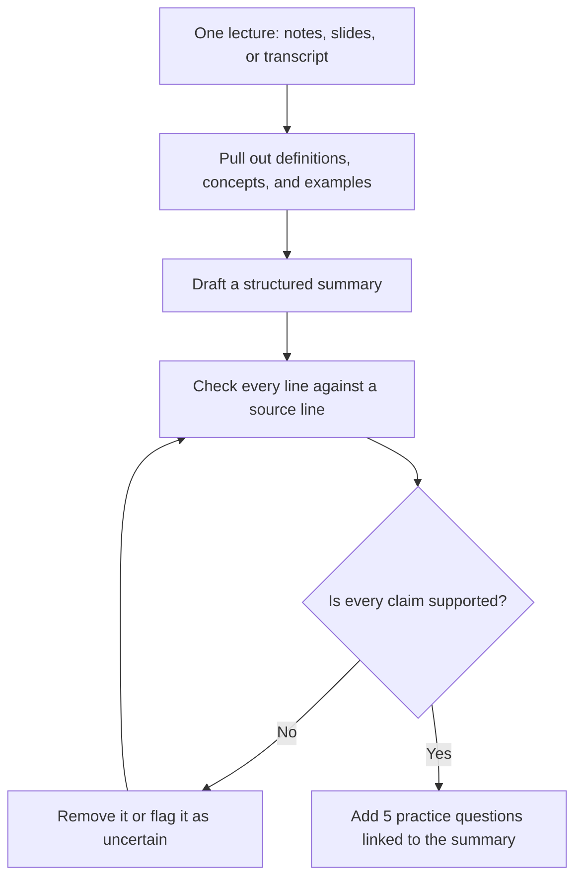

# Lecture Intelligence — Grounded Summaries & Practice Questions

## What this project is

Lecture Intelligence turns one lecture's notes, slides, or transcript into:

1. A structured summary — definitions, concepts, and worked examples.
2. Five practice questions, with answers linked back to the summary.
3. Nothing else. If a point was not in the lecture, it must never appear in the summary.

This is a Practitioner-level AI Product Manager project, built after Phase 06. The product challenge is not "make a longer summary." It is **accuracy and traceability**: every line in the summary must be traceable to a line in the source lecture.

Start with a chat tool, documents, and test sets. The work here is product work with a single obsession: proving, line by line, that nothing in a summary was invented.

## What makes this project unique

This is the only project in the set where **invention itself is the harm**. Other assistants may be unhelpful when they guess; this one can teach a student a false fact that they then carry into an exam. So its method is different from the others: a line-by-line fidelity audit across 6 lectures, where every claim must point to a source line. Its hardest failure is an invented definition that sounds perfectly plausible. Its key test is ≥95% of claims fully supported by the source, with zero invented definitions. Chris, the example student in the story below, misses one biology lecture and memorises a definition that was never in it — the exact mistake this product is built to make impossible.

## The problem

Students miss lectures, take incomplete notes, and revise from fragmented sources. Faculty repeat the same clarifications every term.

An ordinary summariser makes this worse. If it invents a definition, a student may learn that invented definition as fact — and be marked wrong, or worse, misunderstand the subject. The risk is not a poor summary. The risk is confident, wrong learning.

Lecture Intelligence solves this by grounding every claim. A summary line without a source line is not allowed.

## Who it is for

- **Students** who missed a lecture, or whose notes are incomplete, and need a trustworthy way to catch up.
- **Lecturers** who want students to revise from accurate material, without having to re-explain the same points every term.
- **Course teams** who need to know, with evidence, whether a summary can be trusted before students see it.

## How it works

1. **Input:** one lecture only — its notes, slides, or transcript.
2. **Output (a):** a structured summary with definitions, concepts, and worked examples.
3. **Output (b):** five practice questions, each with an answer linked to a summary section.
4. **Rule:** "not in the lecture" must never appear. No external knowledge is added.
5. **Check:** every summary line carries a source-line citation. Anything uncertain is flagged as uncertain, never guessed.

The diagrams in `docs/09-diagrams.md` show the fidelity loop: draft, check every line against a source line, remove or flag anything unsupported, and only then add practice questions.

## The story

Chris misses a biology lecture and learns a wrong definition from an ordinary, ungrounded summary, discovering the mistake only in a test. With Lecture Intelligence, every summary line carries a source line, uncertain points are flagged, and five practice questions check what Chris really learned. Read the full story in [docs/10-story.md](docs/10-story.md).

## How to use this project

This folder is a complete product portfolio piece. Use it in this order:

1. Read `docs/01-problem-statement.md` — the problem and the evidence for it.
2. Read `docs/02-research-notes.md` — what 4 students and 1 lecturer said, and the interview templates to use.
3. Read `docs/03-spec.md` — what is in scope, what is out of scope, and what success looks like.
4. Read `docs/04-eval.md` and `evals/eval-set.csv` — the 6-lecture test set, the rubric, and the line-by-line fidelity audit template.
5. Read `docs/05-metrics.md` — how success, quality, cost, and harm are measured.
6. Read `docs/06-cost-latency.md` — what a semester costs, and why processing happens when it does.
7. Read `docs/07-risks-guardrails.md` — the risks and the guardrails that control them.
8. Read `docs/08-release-portfolio.md` — the staged release plan and the portfolio write-up.

To try the product idea yourself, take one real lecture's notes, run the spec in `docs/03-spec.md` through a chat tool, and then audit the result line by line using the template in `docs/04-eval.md`.

## Portfolio proof

This project proves product judgement with evidence, not claims:

- **One complete worked example:** source → summary → fidelity audit. See `docs/08-release-portfolio.md` for the structure and `docs/04-eval.md` for the audit template. Fill in the worked example with a real lecture.
- **Eval results across 6 lectures:** the test set is in `evals/eval-set.csv`. The result column is left blank / TBD on purpose — results must come from real testing, not be invented here.
- **Lecturer feedback:** a template placeholder is provided in `docs/02-research-notes.md` and `docs/08-release-portfolio.md`. Do not fill it with an invented quote. Fill it only with words a real lecturer actually said, with their permission.
- **The prompt / instruction change that fixed the worst fidelity failure:** documented in `docs/08-release-portfolio.md` as a template to complete after testing. The change, the failure it fixed, and the before/after fidelity scores must come from real eval runs.

Pass bar for this project: **≥95% of summary claims fully supported by the source, and zero invented definitions.**

## Folder contents

- `README.md` — this file.
- `docs/01-problem-statement.md` — problem statement with evidence.
- `docs/02-research-notes.md` — research notes (4 students + 1 lecturer).
- `docs/03-spec.md` — one-page spec.
- `docs/04-eval.md` — eval test set, rubric, results template, and fidelity audit template.
- `docs/05-metrics.md` — metrics plan.
- `docs/06-cost-latency.md` — cost and latency estimate.
- `docs/07-risks-guardrails.md` — risks and guardrails.
- `docs/08-release-portfolio.md` — staged release and portfolio write-up.
- `docs/09-diagrams.md` — simple diagrams: how it works, the user journey, and the eval and release flow.
- `docs/10-story.md` — a fictional example story showing the problem in real life.
- `assets/avatar-chris.svg` — Chris's original initial-letter avatar, used in the story.
- `evals/eval-set.csv` — the 6-lecture eval test set (EXAMPLE data, results TBD).
- `.gitignore` — standard ignores for Node, Python, and system files.

## A note on honesty in this project

All example data in this folder is labelled EXAMPLE. All interview questions and feedback sections are templates. All results tables are blank until real testing fills them in. Nothing here invents a user, a quote, a score, or a result and presents it as real. That honesty is part of the product: a tool that must never invent facts cannot be built on invented evidence.
