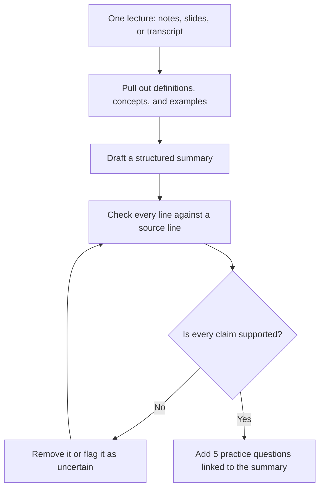
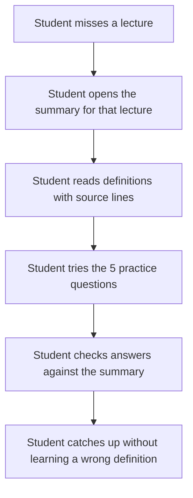
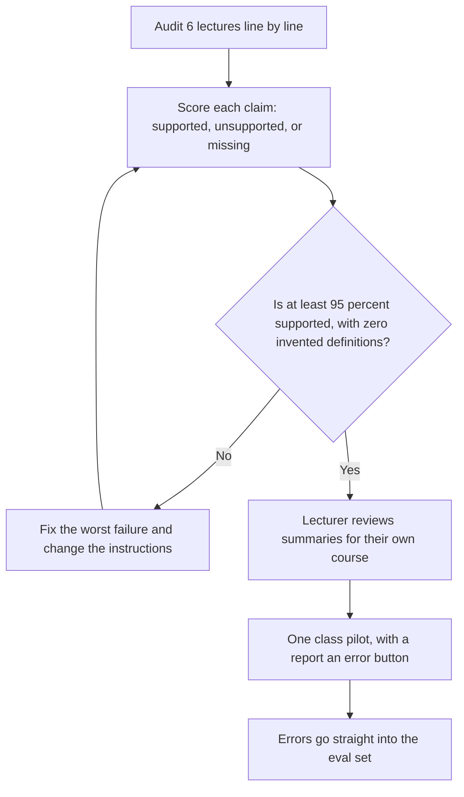

# Diagrams — Lecture Intelligence

These are simple diagrams to help a beginner see how the product works. They match the spec in `docs/03-spec.md`. No image files are used — the diagrams below are written in Mermaid text, which GitHub renders as a picture.

## 1. How it works

What this shows: accuracy comes first. A summary line without a source line is not allowed, and anything uncertain is flagged, never guessed.

## 2. User journey

What this shows: before the product, the student revised from incomplete notes. After it, the student can trust the summary because every claim can be traced back to the lecture.

## 3. Eval and release flow

What this shows: the product is judged by fidelity, not by how long the summary is. Errors reported by students become new test cases.
