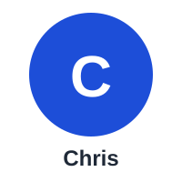

# The story — Lecture Intelligence

**This is an EXAMPLE fictional story.** It is not a real student, a real quote, or a real result. It shows, in plain language, the problem this project solves.

## Meet Chris

Chris misses a biology lecture because he is ill. His notes are incomplete, so he uses an ordinary summariser on a classmate's notes to catch up. The summary sounds clear and confident, and Chris learns its definitions by heart.

The problem is that one definition in the summary was invented. It was not in the lecture at all. Chris learns the wrong definition as fact, and only discovers the mistake when he gets the question wrong in a test.

## Before the product

Chris revises from fragmented sources and has no way to check whether a summary is true. A confident, wrong summary is worse than no summary, because Chris trusts it.

## After the product

Chris opens the summary for the lecture he missed. Every line carries a source line from the lecture, so Chris can check where each definition came from. Anything uncertain is flagged as uncertain, never guessed.

Chris then tries the five practice questions, each linked to a summary section, and checks his answers against the summary. He catches up without learning a wrong definition.

## What the AI PM learns from this

- For a summary, accuracy matters more than length.
- Every claim must be traceable to a source line.
- Uncertainty must be shown, not hidden. A flagged gap is honest; a guessed answer is harmful.
- The product must be tested line by line for fidelity, and errors must become new test cases.
